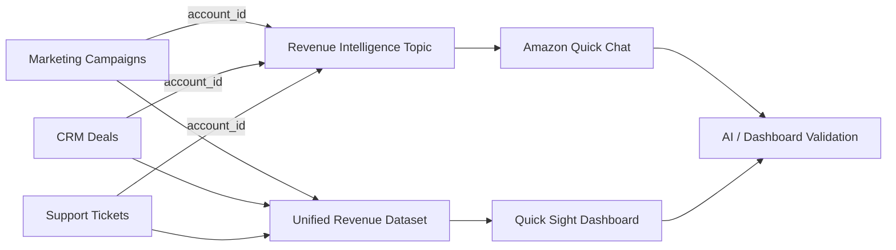
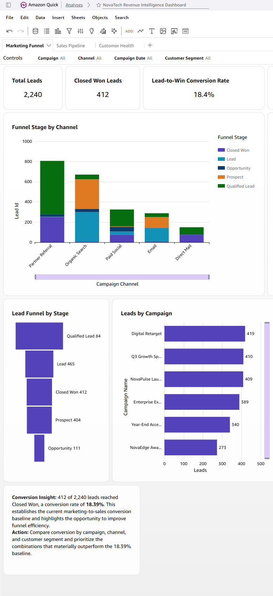
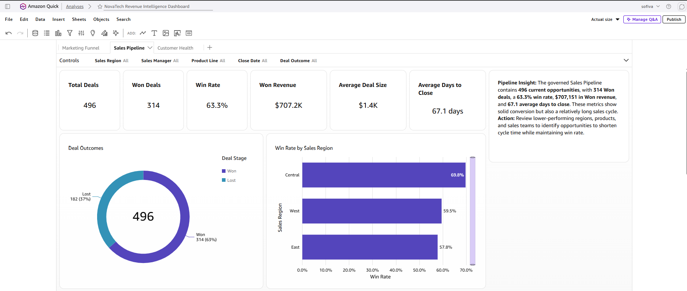
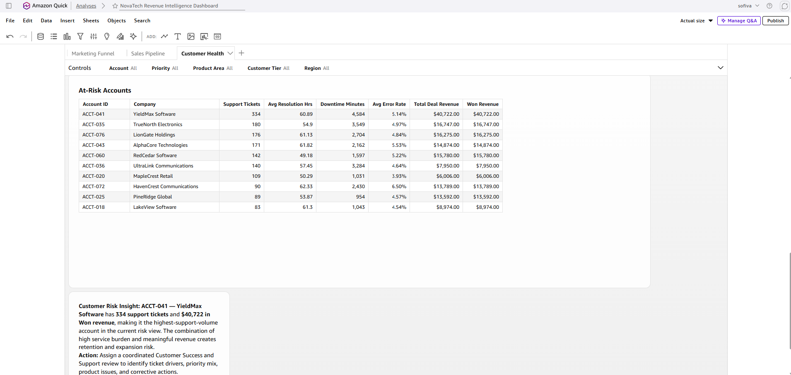
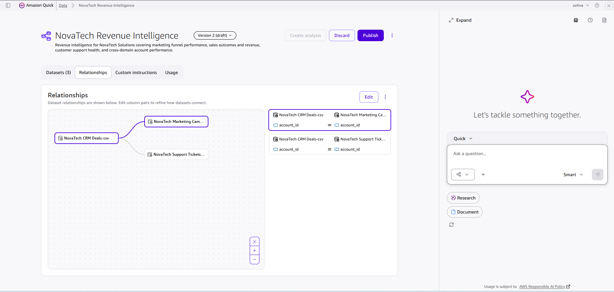
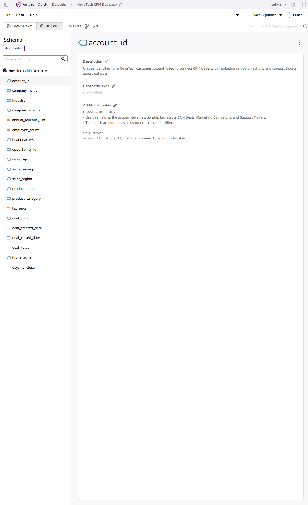
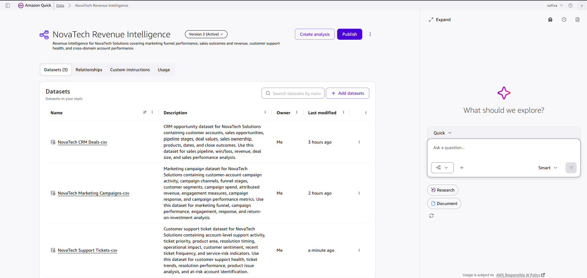

# NovaTech Revenue Intelligence

**End-to-end revenue analytics and governed natural-language BI in Amazon Quick**

This portfolio case study unifies marketing, CRM, and customer-support data into a multi-page revenue intelligence dashboard, then adds a governed semantic layer so business users can ask cross-domain questions in natural language and validate the answers against trusted dashboard logic.

> **Project context:** NovaTech Solutions is a project scenario used to demonstrate business intelligence, data modeling, semantic enrichment, and AI-assisted analytics. The public portfolio intentionally excludes the course-provided source datasets and grading artifacts.

[View the dashboard PDF](assets/NovaTech_Dashboard_All_3_Sheets.pdf) · [Read the case study](docs/CASE_STUDY.md) · [See the AI validation](docs/AI_VALIDATION.md) · [Review metric definitions](docs/METRIC_DEFINITIONS.md)

## Business problem

Revenue Operations needed a single view of the customer journey across three disconnected operational domains:

- **Marketing:** campaigns, funnel stages, engagement, spend, attributed revenue, and ROI
- **Sales:** accounts, opportunities, deal stage, deal value, ownership, and close timing
- **Support:** tickets, priority, product area, resolution time, operational impact, and customer sentiment

The goal was not just to build a dashboard. It was to create a governed analytics experience where leaders could explore the same business questions through both visual BI and natural-language AI without losing metric definitions, record grain, or cross-domain context.

## Solution

I built the solution in **Amazon Quick**, using **Amazon Quick Sight** for business intelligence, **SPICE** for in-memory analytics, and a multi-dataset **Topic** for natural-language analysis.

The implementation included:

- data-quality verification across all three source domains;
- no-code data preparation, type corrections, calculated business fields, and a unified analytical dataset;
- a three-page interactive dashboard for Marketing Funnel, Sales Pipeline, and Customer Health;
- semantic enrichment at the dataset and field level, including business descriptions, synonyms, usage guidance, and custom instructions;
- Topic relationships linking CRM to Marketing and CRM to Support through `account_id`;
- controlled baseline and post-Topic validation to test where AI answers matched—or diverged from—governed dashboard metrics.

## Architecture



The **dashboard path** uses the unified analytical dataset for integrated visual reporting. The **AI path** keeps the three operational datasets at their native granularity and connects them through the Topic semantic layer.

## Dashboard

### Marketing Funnel



**Project finding:** 412 of 2,240 leads reached Closed Won, a conversion rate of **18.39%**. The dashboard also exposes campaign spend, attributed revenue, channel conversion, funnel progression, and campaign-level performance.

### Sales Pipeline



**Governed pipeline metrics:** **496 current opportunities**, **314 Won deals**, **63.3% win rate**, **$707,151 Won revenue**, and **67.1 average days to close**.

A key modeling choice was to calculate current pipeline performance at the **opportunity grain**, rather than treating every CRM row as a distinct deal. Historical versions of an opportunity are excluded from the governed dashboard metrics.

### Customer Health



The Customer Health view combines support burden with commercial context. One notable scenario finding was **ACCT-041 — YieldMax Software**, with **334 support tickets** and **$40,722 in Won revenue**, making it a clear candidate for coordinated support and customer-success review.

## Semantic layer and natural-language BI

The Topic was configured around three enriched datasets—CRM Deals, Marketing Campaigns, and Support Tickets—with explicit business semantics and relationships.



Examples of enrichment included:

- defining `account_id` as the shared customer-account key across all three domains;
- distinguishing **marketing funnel stage** from **CRM deal stage**;
- distinguishing **marketing-attributed revenue** from **realized Won revenue**;
- documenting aggregation behavior for fields such as resolution time and campaign ROI;
- adding synonyms such as *customer ID*, *pipeline stage*, *marketing ROI*, and *time to resolution*;
- adding Topic-level cross-domain instructions for source selection, aggregation safety, and account-level reasoning.



The final Topic was published and active for natural-language analysis.



## AI validation: where the model agreed—and where it did not

The most important part of this project was validating AI-generated answers instead of assuming that a plausible response was correct.

| Test | Governed dashboard | Topic result | Outcome |
|---|---:|---:|---|
| Marketing conversion | 412 / 2,240 = **18.39%** | 412 / 2,240 = **18.39%** | Exact agreement |
| Cross-domain account risk | ACCT-041, **334 tickets**, **$40,722 Won revenue** | Same | Exact agreement |
| Sales performance | 496 opportunities, 314 Won, 63.3%, $707,151, 67.1 days | 496 distinct opportunities, 315 Won, 63.51%, $707,201, 66.8 days | Partial disagreement |

The sales discrepancy exposed a governance issue that is easy to miss in generative BI: the dashboard applies a **latest-opportunity-record rule** before calculating current pipeline metrics, while the generated Topic query did not fully reproduce that analysis-level filter. The AI answer improved after semantic enrichment—from 499 raw CRM rows to 496 distinct opportunities—but still differed slightly on Won count, revenue, and close time.

That result is documented in detail in [AI Validation](docs/AI_VALIDATION.md).

## What this project demonstrates

- **Business intelligence design:** translating executive questions into focused KPI and visual structures.
- **Data modeling:** preserving domain grain while supporting both unified reporting and runtime cross-dataset reasoning.
- **Metric governance:** defining deal counts, Won revenue, conversion, ROI, and support measures precisely enough to survive multiple consumption layers.
- **Generative BI:** using semantic metadata, synonyms, relationships, and custom instructions to improve natural-language analytics.
- **Responsible AI practice:** validating AI-generated numbers against governed dashboards, inspecting explanations, and documenting residual disagreement instead of forcing a match.
- **Executive communication:** turning quantified findings into implications and recommended actions directly on the dashboard and in an executive report.

## Technology

- **Amazon Quick** — AI-powered workspace
- **Amazon Quick Sight** — data preparation, analysis, dashboarding, and reporting
- **SPICE** — in-memory analytics engine
- **Quick Sight Topics** — multi-dataset semantic layer
- **Amazon Quick chat** — natural-language exploration and cross-dataset Q&A
- No-code data preparation, calculated fields, filters, relationships, and dashboard annotations

## Repository structure

```text
.
├── README.md
├── assets/
│   ├── marketing-funnel.png
│   ├── sales-pipeline.png
│   ├── customer-health.png
│   ├── topic-relationships.png
│   ├── topic-semantic-metadata.png
│   ├── topic-active.png
│   └── NovaTech_Dashboard_All_3_Sheets.pdf
├── docs/
│   ├── CASE_STUDY.md
│   ├── AI_VALIDATION.md
│   ├── DATA_MODEL.md
│   └── METRIC_DEFINITIONS.md
├── data/
│   └── README.md
├── linkedin/
│   ├── LINKEDIN_PROJECT_ENTRY.md
│   └── OPTIONAL_LAUNCH_POST.md
├── GITHUB_SETUP.md
└── NOTICE.md
```

## How to review this project

1. Open the [three-sheet dashboard PDF](assets/NovaTech_Dashboard_All_3_Sheets.pdf).
2. Read the [case study](docs/CASE_STUDY.md) for the end-to-end design rationale.
3. Read [AI Validation](docs/AI_VALIDATION.md) for the semantic-layer and governance analysis.
4. Review [Metric Definitions](docs/METRIC_DEFINITIONS.md) for the business rules behind the dashboard.

## Current AWS terminology

Amazon Quick is AWS's AI-powered workspace, and **Amazon Quick Sight** is its business-intelligence and data-visualization component. Quick Sight Topics provide a multi-dataset semantic layer, while Amazon Quick chat can use Topic relationships, dataset enrichment metadata, and custom instructions to answer cross-dataset natural-language questions.

## References

- Amazon Quick overview: https://docs.aws.amazon.com/quick/latest/userguide/what-is.html
- Amazon Quick Sight overview: https://docs.aws.amazon.com/quick/latest/userguide/quick-bi.html
- SPICE: https://docs.aws.amazon.com/quick/latest/userguide/spice.html
- Dataset Enrichment: https://docs.aws.amazon.com/quick/latest/userguide/dataset-enrichment.html
- Quick Sight Topics: https://docs.aws.amazon.com/quick/latest/userguide/topics.html
- Amazon Quick chat: https://docs.aws.amazon.com/quick/latest/userguide/using-quick-chat.html

## Data and publication note

This repository is a **portfolio case study**, not a production deployment. The source datasets and course/grading materials are intentionally omitted. The screenshots, dashboard export, documentation, and analysis describe the work performed in the project scenario without publishing restricted starter data.
