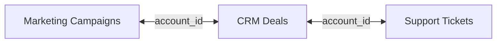

# Data Model

## Source domains

| Dataset | Primary business purpose | Key examples |
|---|---|---|
| CRM Deals | Sales pipeline and revenue outcomes | `account_id`, `opportunity_id`, `deal_stage`, `deal_value`, `days_to_close` |
| Marketing Campaigns | Funnel, campaign, engagement, and ROI analysis | `account_id`, `campaign_name`, `campaign_channel`, `funnel_stage`, `campaign_roi_pct` |
| Support Tickets | Customer health and service-risk analysis | `account_id`, `ticket_id`, `priority`, `resolution_time_hours`, `customer_sentiment` |

## Relationship model

The semantic Topic uses `account_id` as the cross-domain customer key:

CRM serves as the semantic bridge for sales outcomes, while Marketing and Support contribute upstream and downstream customer context.

## Why the unified dataset is separate from the Topic

The dashboard uses a unified analytical dataset because a flattened view is convenient for integrated visuals and executive reporting.

The Topic, however, uses the three operational datasets directly. This avoids adding the already-unified dataset back into the semantic graph, which could create redundant relationship paths and make cross-dataset query selection harder to reason about.

## Grain considerations

The most important grain issue is in CRM:

- raw CRM population: **499 rows**;
- governed current sales population: **496 distinct opportunities**;
- `opportunity_id` is the deal grain;
- current pipeline metrics use the latest opportunity record rather than every historical row version.

That distinction materially affects Won count, revenue, and close-time calculations when AI queries the raw dataset without the latest-record rule.
